<div align="center">

[](https://tharunbabu-05.github.io/moon_walker/)

**A shared Moon expedition. A handful of regolith. A race under the stars.**

[**Play in your browser →**](https://tharunbabu-05.github.io/moon_walker/) · [Invite your crew](#explore-with-friends) · [Controls](#controls) · [Run locally](#run-locally)

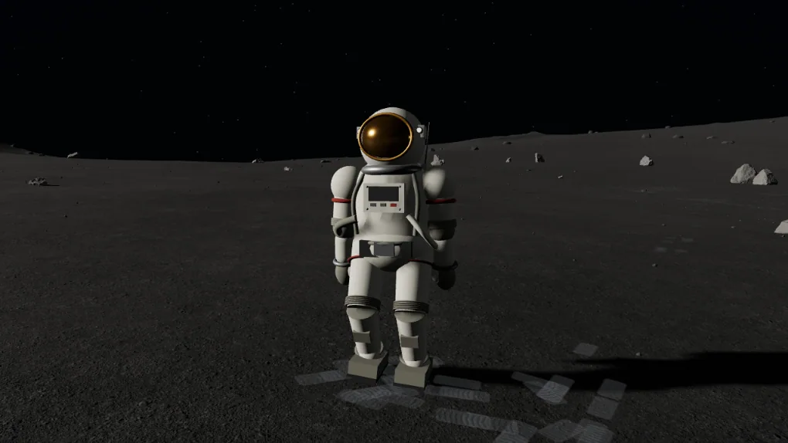

**3 camera views** · **Up to 8 explorers** · **2 suit designs** · **1 shared Moon**

</div>

SELENE is a 3D lunar exploration game built for the browser. Walk across cratered highlands, drive a suspended lunar buggy, collect rock and soil samples, and explore with friends. Visit a research outpost and historical flag exhibits, then head to a permanent stadium for a two-lap race across raw lunar terrain. Zoom out from the astronaut to the Moon and the Earth–Moon system.

## See it in motion

Looping GIFs converted from the project's four gameplay recordings. These captures span earlier builds; the feature guide below describes the current game.

| An expedition in miniature | Walking the highlands |
| :---: | :---: |
| 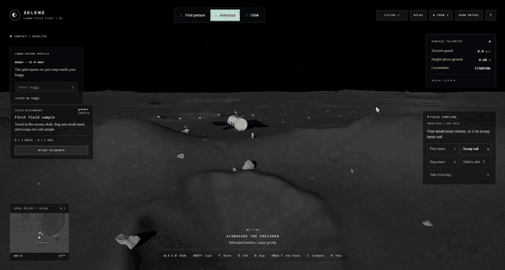 | 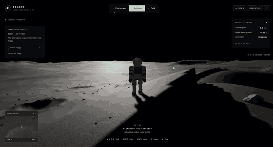 |
| A camera tour from the outpost to the explorer. | Low-gravity movement seen from the follow camera. |

| Taking the buggy out | Leaving a trail |
| :---: | :---: |
| 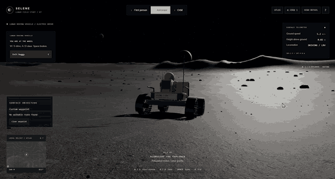 | 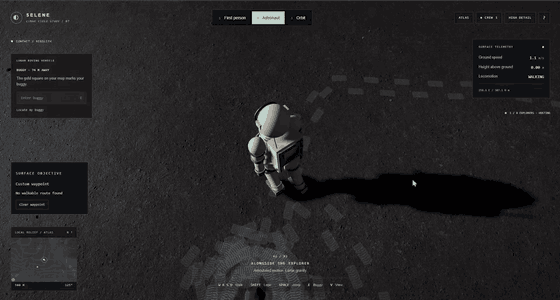 |
| Driving, changing camera angle and stepping out. | Bootprints record the path across the regolith. |

**Explore the guide:** [The Moon](#explore-the-moon) · [Buggy](#drive-the-lunar-buggy) · [Samples and throws](#collect-samples-and-aim-your-throws) · [Maps and flags](#navigate-the-moon-and-its-history) · [Research station](#visit-the-research-outpost) · [Stadium](#race-at-crater-stadium) · [Crew](#explore-with-friends) · [Suits and sound](#make-the-expedition-yours)

## Explore the Moon

Move from a visor-level view of the regolith to a follow camera around your astronaut, then pull back to the whole lunar globe. The surface features impact craters, sloping bedrock, detailed rocks, footprints, dust and long shadows. Walking, loping and jumping use lunar gravity of **1.62 m/s²**.

| On the surface | Above the Moon |
| :---: | :---: |
| 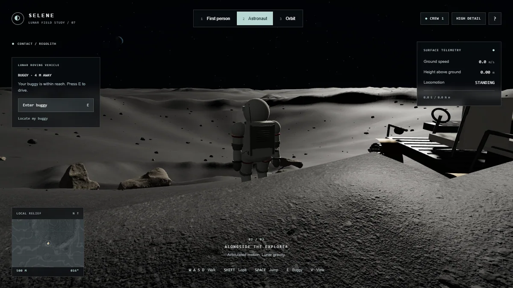 | 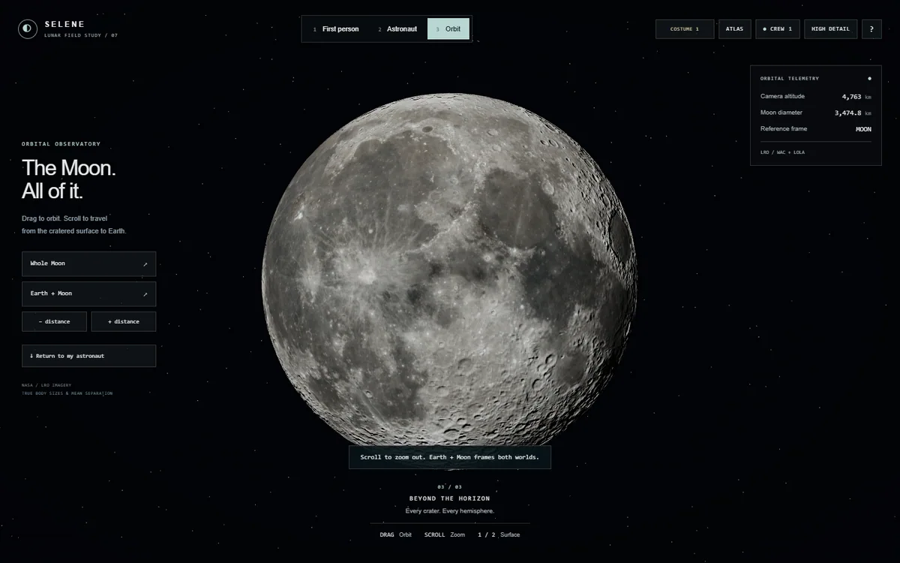 |
| Explore on foot with first-person and astronaut cameras. | Orbit the NASA-mapped Moon, then zoom out toward Earth. |

The orbital Moon uses NASA LRO colour and elevation products. The walkable landscape is procedurally generated; it is not a surveyed reconstruction of an Apollo landing site. Close rocks use photographed Poly Haven models with colour, normal and roughness maps.

<details>
<summary><strong>View the Earth–Moon system</strong></summary>

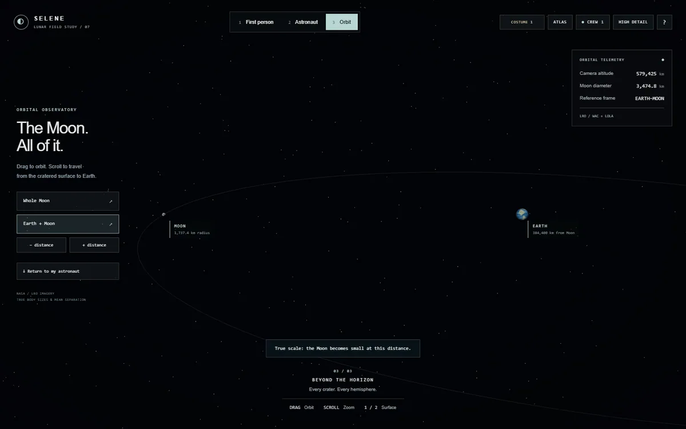

The orbital view uses mean body radii and mean Earth–Moon separation. At this scale the Moon is small beside Earth. Press **3** and scroll out to explore the system.

</details>

## Drive the lunar buggy

Approach any stopped exploration buggy and press **E** to board. The first entrant drives; the second sits beside them as a passenger, even when the buggy belongs to a crewmate. Stop before either person exits. To swap drivers, both get out and the new driver boards first. Drive in first person or orbit the camera around the vehicle. The astronaut grips the steering wheel, and stopping before exiting triggers the climb-out animation.

| A vehicle for the expedition | Connected suspension |
| :---: | :---: |
| 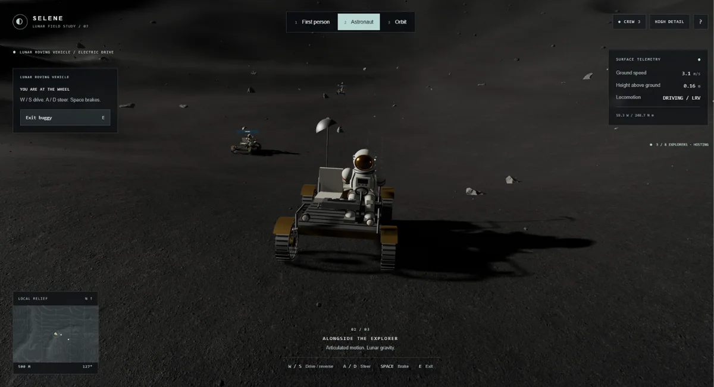 | 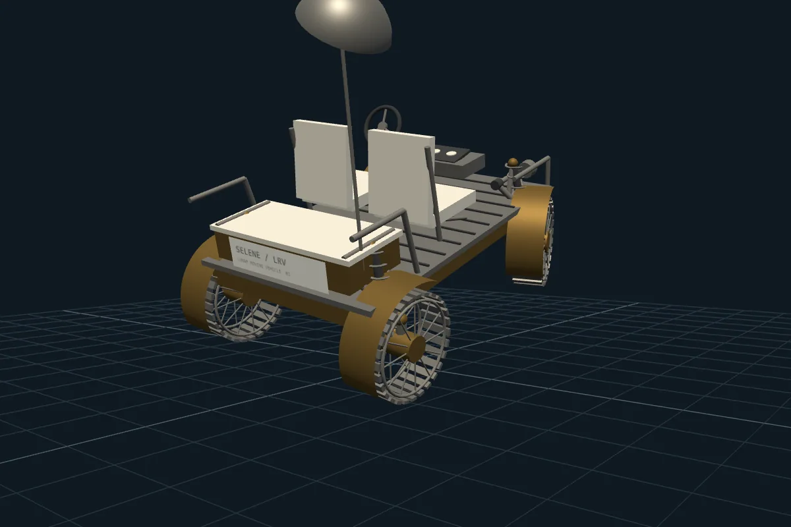 |
| Each crew member spawns with a shared two-seat exploration buggy. | Wishbones, steering knuckles, coil springs and telescoping dampers connect the wheels to the chassis. |

Tyres respond to small bumps while low stones between the wheel tracks can pass beneath the chassis. Exploration buggy driving, rock contact and mechanical suspension use the original behavior from commit `85a23c2`: taller rocks stop the chassis, suspension follows wheel height, and gradual crests do not launch the buggy. Shared driver/passenger seats remain available. These are tuned game physics, not a full engineering vehicle simulation.

<details>
<summary><strong>Another view from the expedition</strong></summary>

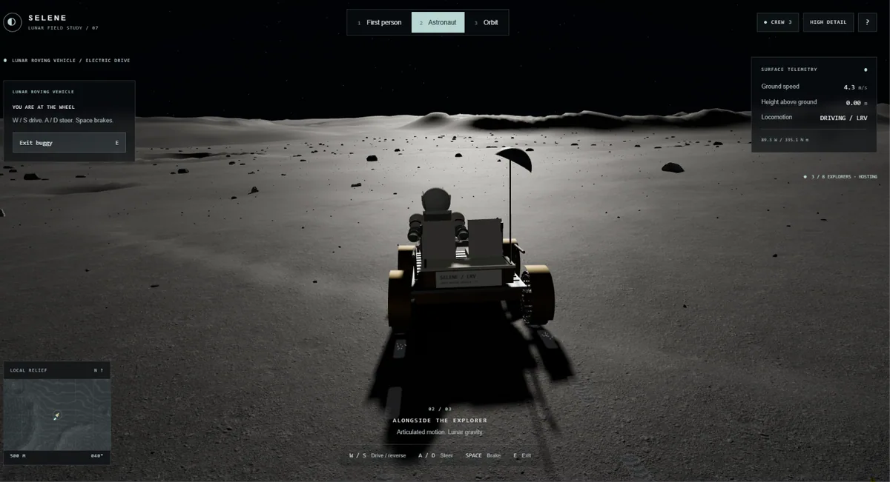

</details>

## Collect samples and aim your throws

Find a loose, hand-sized stone and stop within reach. A gold ring marks the nearest collectible. The explorer turns, crouches, reaches and holds the specimen in the right glove. Large fixed boulders and decorative gravel stay in place.

| Rock collection | Soil collection |
| :---: | :---: |
| 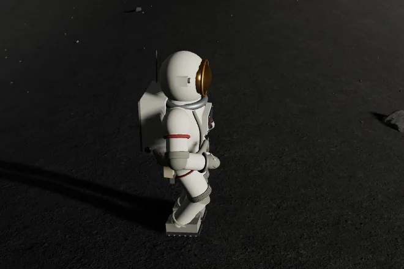 | 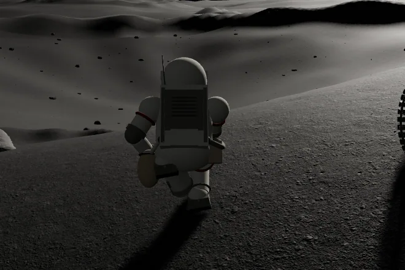 |
| **F** picks up a stone. **B** bags it. **R** retrieves it. | **G** draws the shovel, scoops regolith, pours it into the bag and stows the tool. |

Each bag holds **12 samples**. Sampling preserves your follow-camera angle, so you can watch from the front or side. Stow a held stone before boarding a vehicle.

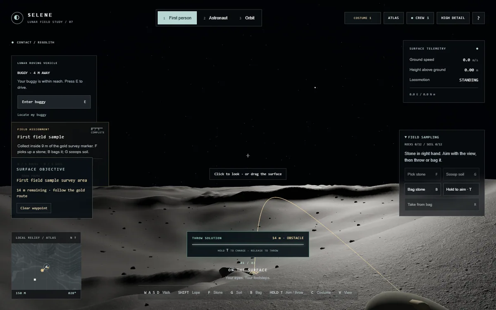

**Hold T to aim; release to throw.** A temporary first-person view shows the predicted arc and landing point as throw power builds. After release, your previous camera view returns. **Esc** cancels aiming. Stones spin, bounce, slow on contact and produce impact dust; hitting another explorer triggers a short suit-recoil animation.

**Field assignments:** the first-assignment prompt points you to the mission panel and map. Accept one of three survey tasks, follow the gold route into the outlined survey circle, then follow the pickup, bagging and soil-scooping prompts. Return to the labelled **sample receiving bench beside the station ramp**. Stand within reach and choose **Hand over samples**; the astronaut places a pouch in the tray and the mission advances after the hand-over action. Sample bags remain yours if the action is interrupted before placement.

## Navigate the Moon and its history

Open **ATLAS**, press **M**, or click the mini-map. The surface map shows your position; click a destination to pin it and see a suggested route on the bottom-left mini-map. Pan, zoom or select **Centre on me** to return to your location.

| Plan your route | Explore real mission locations |
| :---: | :---: |
| 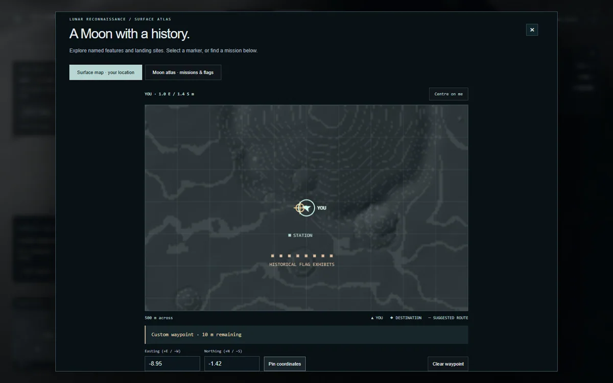 | 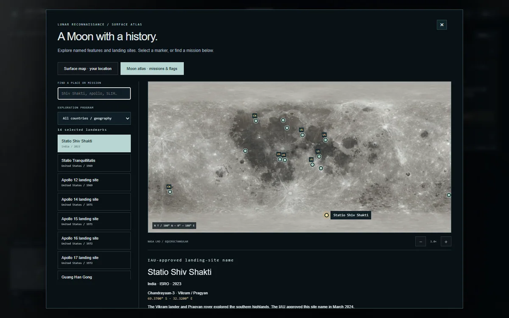 |
| Local coordinates, waypoints and route guidance. | 14 curated lunar features and landing sites, country filters and source links. |

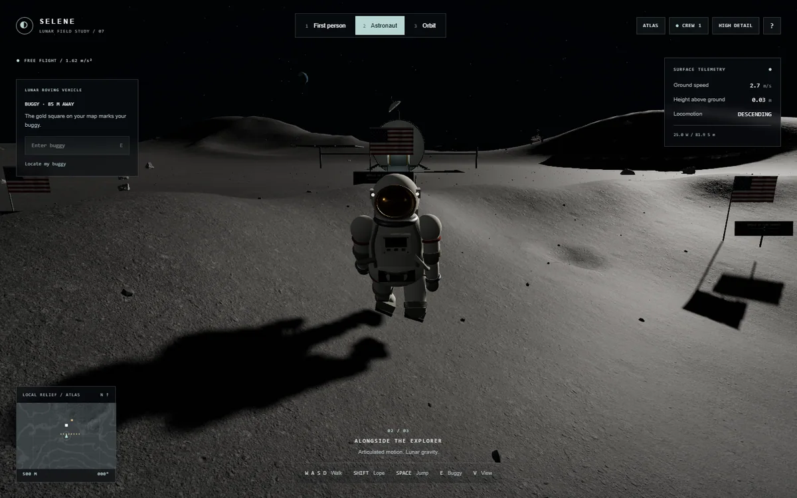

**Eight historical flag exhibits** represent the six Apollo deployments and the Chang'e 5 and 6 lander-mounted displays. Atlas entries connect their mission history to the local exhibit trail and to markers on the 3D Moon. The flags are labelled reconstructions; their nearby exhibit positions are not the real landing coordinates. Country labels identify exploration programs, not ownership of lunar terrain.

## Visit the research outpost

SELENE Research Outpost is the expedition's fictional surface station: a pressure-vessel-style habitat with a ramp, proximity airlocks, windows, equipment racks, a sample bench, interior lights, solar wings, radiator and communications dish.

| Arrive at the airlock | Step inside |
| :---: | :---: |
| 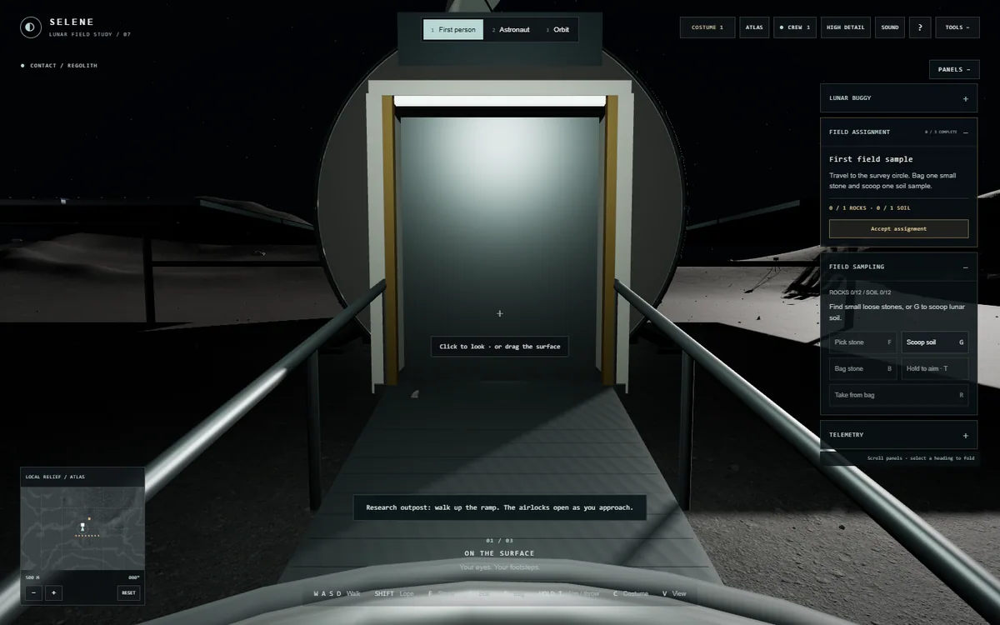 | 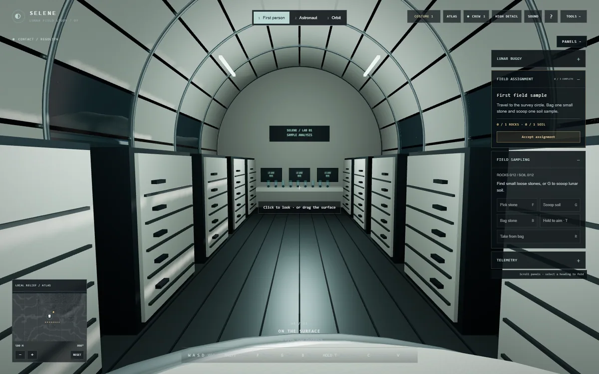 |

Choose **Visit research station** in the atlas to reach the outpost. Doors respond to nearby explorers, and the white square on the mini-map marks the station. This is a concept habitat inspired by lunar infrastructure, not a real station currently operating on the Moon.

## Race at Crater Stadium

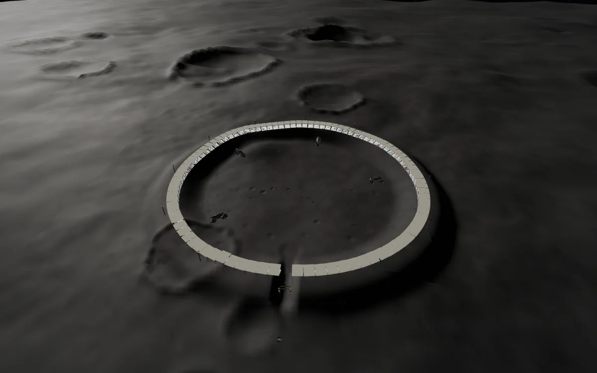

**A permanent stadium on the same Moon.** Its entrance sits **300 m east of the habitat centre**, opening into a **1.2 km-radius** arena with 95 roofed grandstand sections, roughly 19,000 suited spectators and 24 floodlight towers.

| The course | The paddock |
| :---: | :---: |
| 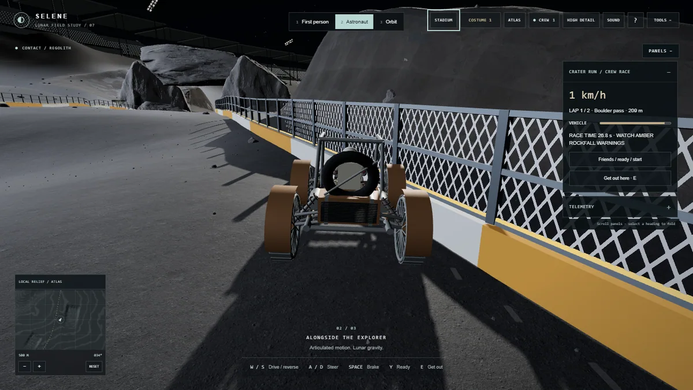 | 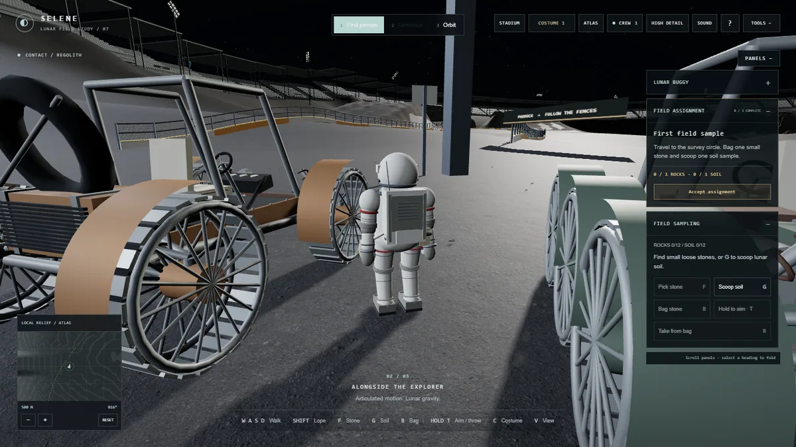 |
| Continuous **3.8 m fences** define both sides of the regolith track. | **8 parked vehicles**, with **4 distinct designs** to choose from. |

Drive Rustwalker, six-wheel Iron Mule, roofed Dune Jackal or Red Prospector. The cars feature exposed frames, oversized wheels, visible suspension, roll cages, cargo and different finishes. The course crosses crater slopes, depressions, large bedrock shelves and rock arches. Amber warning rings announce falling boulders.

### Start a race with friends

1. Create or join a **CREW** expedition using an invite link or expedition code.
2. Open **STADIUM → Route to parked vehicles** and follow the entrance lamps to the off-track garage. Approach a free racer and press **E** within 6 m to board.
3. Every seated driver presses **Y** or selects **Ready**. **R** remains the stone-retrieval key while on foot.
4. With **at least two ready drivers**, the host selects **Host: start race**. Joining the crew alone does not start a race. Use **Solo practice** when playing alone.
5. Ready drivers are placed at the start gantry. After the shared **five-second countdown**, pass **16 checkpoints in order** for **two laps**. The large **START / FINISH** gantry marks the lap line. The top-center display shows position, lap, elapsed race time, and each driver's current lap time. Finishers retain their final time; standings sort by completed laps, ordered checkpoints and progress.

Vehicle collisions and falling rocks cause damage. Destruction triggers recovery **after four seconds at the destruction position**, followed by two seconds of protection. This build is a checkpoint race with environmental hazards; it has no guns or AI opponents. Stop and press **E** to step out beside your car.

<details>
<summary><strong>Look inside the grandstands</strong></summary>

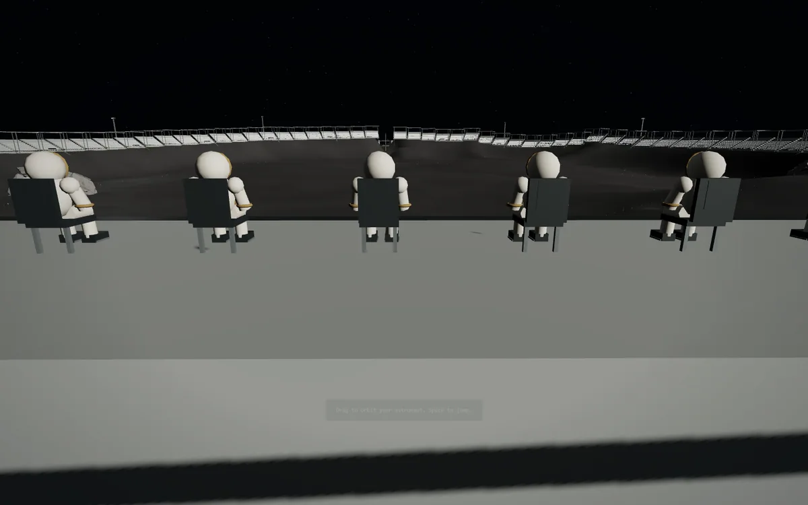

Crowds and stadium structures use instancing, with more detailed geometry near the camera. Four nearby floodlight sources illuminate the track at a time to limit rendering cost.

</details>

## Explore with friends

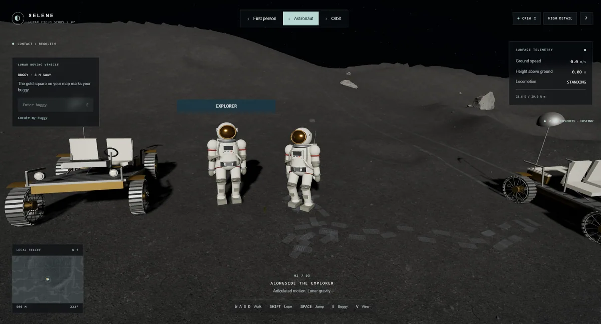

**Up to eight players can share an expedition. No account is required.**

1. Open [SELENE](https://tharunbabu-05.github.io/moon_walker/) and select **Step onto the Moon**.
2. One player opens **CREW**, enters a callsign and selects **Start an expedition**.
3. Select **Copy invite** and share the link, or share the eight-character expedition code.
4. Friends open the link, enter their callsign and select **Join crew**. With a code, enter it in **CREW** instead.

Explore together with callsigns, map markers, personal buggies, shared sampling and synchronized race vehicles. The host coordinates sample ownership, throws, hits, assignments and race state.

Keep the **host tab open and active**. Everyone should refresh to the same version before creating a new invite. Sessions are temporary: there are no persistent accounts, saved inventories, public matchmaking or automatic host migration. Multiplayer uses PeerJS signalling and direct WebRTC connections; restrictive networks can prevent joining. GitHub Pages serves the game files rather than relaying player movement.

## Make the expedition yours

| Costume 1 | Costume 2 |
| :---: | :---: |
| 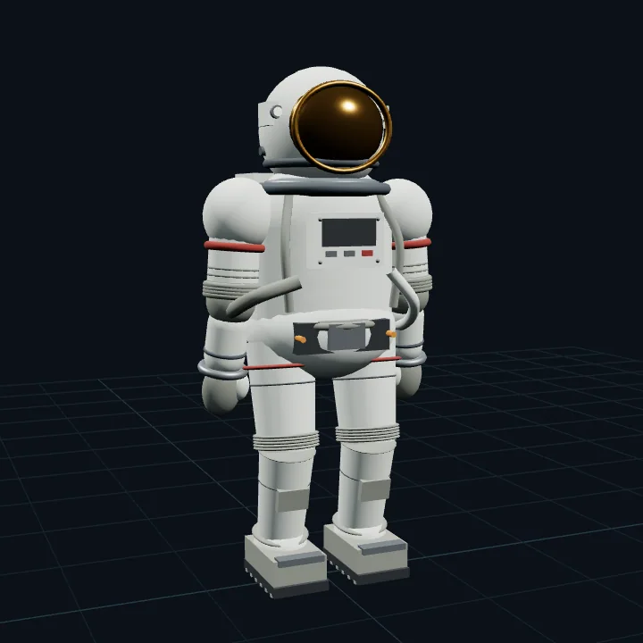 | 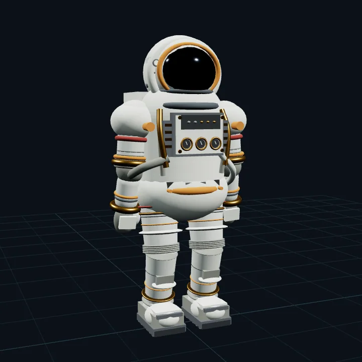 |
| The original SELENE EVA outfit. | A padded suit with gold seals, layered boots and a detailed chest console. |

These detail views render the actual game models in a studio setup. Press **C** to switch costumes; your crew sees the change. Your selection is saved on your device.

**Sound:** footsteps, landings, sampling, rock impacts, suit hits, vehicle entry, motor and rolling feedback, aiming tones and interface clicks. Open **SOUND** to adjust master volume, suit ambience and mute. Audio begins after entering the game and pauses when the tab loses focus. Outdoor effects are a cinematic suit feed, not sound travelling through a vacuum.

**Your layout:** collapse individual panel headings, hide the right-side stack with **PANELS**, or fold the top-right controls with **TOOLS**. Drag the mini-map by its header, resize it with **− / +**, and use **RESET** to restore its position. The layout adapts to the viewport, with local preferences saved on your device. **H** hides the interface for a clearer view.

## Controls

| Context | Key / input | Action |
| --- | --- | --- |
| On foot | **W A S D** / arrows | Walk relative to the camera |
| On foot | **Shift** / **Space** | Lope / jump |
| Camera | **1 / 2 / 3** | First person / astronaut / orbit |
| Camera | **V**, drag, scroll | Cycle view, look around, zoom |
| Sampling | **F / B / R / G** | Pick stone / bag / retrieve / scoop soil |
| Throwing | **Hold T**, release | Charge and aim, then throw; **Esc** cancels |
| Vehicle | **E** | Board nearby vehicle / exit after stopping |
| Driving | **W / S**, **A / D**, **Space** | Drive/reverse, steer, brake |
| Exploration buggy | **Shift** | Raise the speed limit |
| Race lobby | **Y** | Toggle ready while seated in a racer |
| Navigation | **M** | Open atlas and surface map |
| Appearance | **C** | Change costume |
| Interface | **H / Esc** | Hide interface / release mouse look |

Touch controls include a walk pad, drag-to-look and pinch-to-zoom. Sampling actions also have on-screen buttons. For racing, keyboard controls are the documented driving interface.

## Run locally

The [hosted game](https://tharunbabu-05.github.io/moon_walker/) needs no installation. For local development, install Node.js with npm, then:

```sh
git clone https://github.com/TharunBabu-05/moon_walker.git
cd moon_walker
npm install
npm start
```

Open **http://localhost:8000**. On Windows, use `npm.cmd` if PowerShell blocks `npm.ps1`. Use the local server rather than opening `index.html` directly. Solo exploration works with the bundled assets; multiplayer needs internet access.

## Built with

| Layer | Implementation |
| --- | --- |
| Rendering | Three.js, WebGL, GLTF models, instanced scenery and terrain detail levels |
| Simulation | Custom lunar locomotion, vehicle suspension, swept contact and ballistic samples |
| Background work | Web Workers for terrain chunks, rock fields, route planning and relief maps |
| Multiplayer | PeerJS + WebRTC, host authority, buffered remote motion and race client prediction |
| Audio | Web Audio, locally bundled Kenney effects and procedural suit/vehicle sounds |
| Delivery | Static HTML, CSS and JavaScript hosted on GitHub Pages |

[Development, testing and simulation notes →](docs/DEVELOPMENT.md) · [Research notes →](RESEARCH.md) · [Pages workflow →](.github/workflows/pages.yml)

## Contributing

Help improve the Moon with bug reports, performance fixes, accessible controls, documentation and appropriately licensed assets. Read [CONTRIBUTING.md](CONTRIBUTING.md) for setup, verification and pull request guidance.

## License

SELENE is licensed under the **[GNU General Public License v3.0](LICENSE)**. When distributing covered software, preserve the licence notices and provide the corresponding source under the applicable GPL terms. Read the licence for the full conditions.

Bundled libraries, models, textures and sounds retain their individual terms; see [asset attribution](assets/ATTRIBUTION.md) and the notices in `vendor/`.

## Security

Please report vulnerabilities through the private channel described in [SECURITY.md](SECURITY.md). The policy covers the current hosted game and `main`, including multiplayer input, dependencies and deployment concerns.

## Credits and media

Built by **[Tharun Babu](https://github.com/TharunBabu-05)**. Gameplay photos and videos supplied in `video_proof/`; supporting screenshots captured from the project. All four recordings are converted to silent GIFs. Some gallery images show earlier interface and suit revisions.

- **NASA SVS:** orbital Moon colour and elevation products.
- **Poly Haven:** photographed rock models and regolith material sources, CC0.
- **Kenney:** impact and interface sound recordings, CC0.
- **Three.js / PeerJS:** MIT-licensed libraries; bundled licence files are retained.

See [full asset attribution](assets/ATTRIBUTION.md), [audio credits](assets/audio/README.md), and the [media sources and GIF conversion guide](docs/media/README.md) for provenance and reproduction instructions. Third-party asset licences apply to their respective assets.

---

<div align="center">

**Leave footprints. Bring back samples. Meet your crew on the grid.**

[**Step onto the Moon →**](https://tharunbabu-05.github.io/moon_walker/)

</div>
